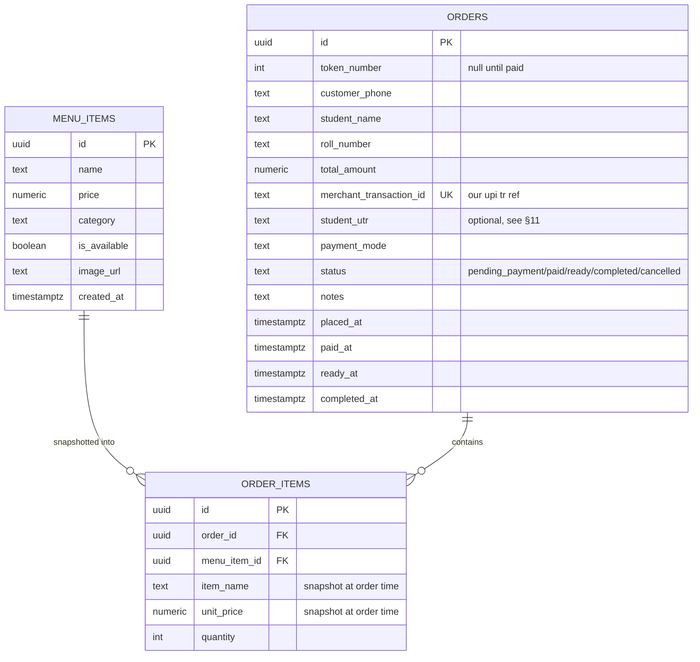

# LineZero

A canteen pre-order system: WhatsApp chat ordering and web menu → pay via UPI
deep link → live staff dashboard. See
[ARCHITECTURE_UPI_Deep_Linking_Prototype.md](ARCHITECTURE_UPI_Deep_Linking_Prototype.md)
for the full design.

## Data model



`order_items` denormalizes `item_name`/`unit_price` off `menu_items` at order time, so a
later menu price change never rewrites past order history. `assign_next_token` (in
`schema.sql`) is the only writer of `token_number`/`status='paid'`/`paid_at`, and runs
under an advisory lock so two simultaneous payments can't collide on a token.

## Setup

1. **Supabase**
   - Create a project at https://supabase.com.
   - Open the SQL editor and run `schema.sql` (creates tables, `assign_next_token`,
     RLS policies, enables Realtime on `orders`, and seeds the menu).
   - Copy the project URL, `anon` key, and `service_role` key from
     Project Settings → API.

2. **WhatsApp**
   - Use the GetGabs WhatsApp Business account and configure its inbound webhook
     to `https://<your-api-host>/wa/webhook?token=<GETGABS_WEBHOOK_TOKEN>`.
   - Set a separate random `GETGABS_WEBHOOK_TOKEN` and the production
     `GETGABS_API_KEY` in the backend secret store.
   - In WhatsApp chat, type `MENU`, then order like `1x Bread Omelet, 2x Chai`.
     After paying, reply `PAID <order reference>`; use `CANCEL <order reference>`
     to cancel a pending order.
   - The integration replies to customer-started chats; bulk campaigns are not
     part of this pivot. GetGabs service replies require an active WhatsApp
     customer-service window; business-initiated messages need an approved,
     opted-in template audience.
   - Run `migrations/001_whatsapp_customer_phone.sql` against an existing database.

3. **UPI**
   - Decide the canteen's own UPI ID (e.g. `canteen@oksbi`) and a display name.
   - No PG, no KYC, no signup — see §8 of the architecture doc.

4. **Environment**
   - Copy `.env.example` to `.env` and add the Supabase, GetGabs, and UPI values.
   - `UPI_REDIRECT_BASE_URL` should point at wherever this service is reachable
     over HTTPS (your Fly.io app URL once deployed; for local testing, an ngrok/
     Cloudflare Tunnel URL).

5. **Install & run locally**
   ```
   python -m venv .venv
   .venv/Scripts/activate        # Windows
   pip install -r requirements.txt
   python -m app.main
   ```
   This starts the FastAPI server (`/wa/webhook`, `/pay/{txn_id}`, `/health`)
   on `PORT` (default 8080).

6. **Dashboard**
   - Open `dashboard.html`, fill in `SUPABASE_URL` and `SUPABASE_ANON_KEY` near
     the top of the `<script type="module">` block.
   - Deploy by dragging the file onto Netlify (or any static host) — no build step.

## Deploy (Fly.io)

```
fly launch
fly secrets set GETGABS_API_KEY=... GETGABS_WEBHOOK_TOKEN=... SUPABASE_URL=... SUPABASE_SERVICE_ROLE_KEY=... UPI_VPA=... UPI_PAYEE_NAME=... UPI_REDIRECT_BASE_URL=...
fly deploy
```

`auto_stop_machines = false` and `min_machines_running = 1` in `fly.toml` keep
the webhook service available — do not change these.

## Deploy (Render)

Create a Blueprint from this repository using `render.yaml`. Set the required
Supabase and UPI values in the Render dashboard; configure `CORS_ORIGINS` with
the Vercel frontend origin(s), separated by commas. Set `PORT` to `10000`
unless you configure a different port in Render. Set `UPI_REDIRECT_BASE_URL` to
the Render service URL after it is created, and set the GetGabs values if
WhatsApp messaging/webhooks are enabled.

## Payment verification posture

There is no gateway in this design — the deep link pays the canteen's own UPI ID
directly. A customer reply of `PAID <order reference>` is trusted at face value,
as the former Telegram confirmation was; it assigns a token but does not verify
the bank transfer.
See §11/§13 of the architecture doc for the UTR-capture upgrade path.
